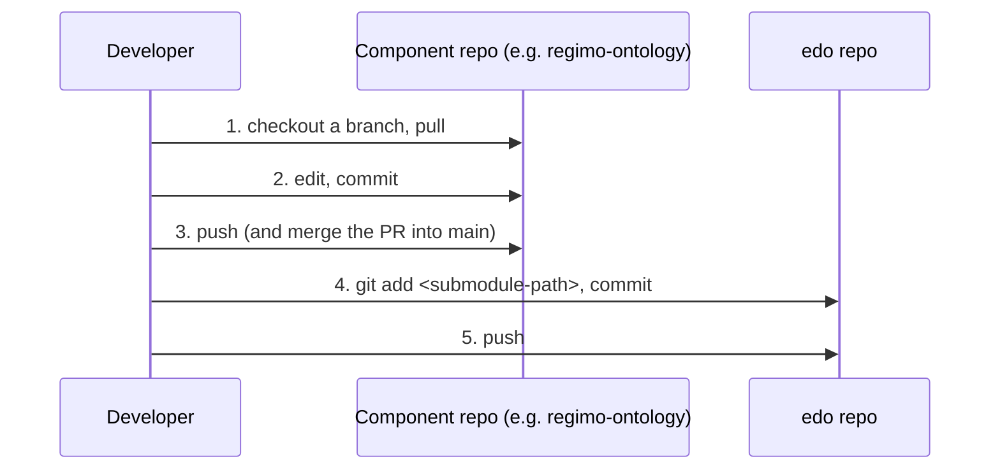

# edo
An Ontology-Aware Energy Data Orchestrator. A microservice-based framework for intelligent energy system integration
via Kafka. Developed at Karlsruhe Institute of Technology (KIT).

`edo` is the **umbrella repository** of the Regimo ecosystem. It does not contain most of the component code itself;
instead it pins each component repository (ontology, core, sockets, infrastructure, frontend) as a **Git submodule**
at a specific commit. This keeps ontology definitions, infrastructure (Kafka) and functional microservices decoupled,
with independent histories and release cycles, while still being easy to orchestrate together.

## Project Structure

```orga
edo/                                    ← umbrella repo  (git@github.com:koubaa-hmc/edo.git)
├── core/                               ← submodule: regimo-core
├── schema/
│   └── ontology/                       ← submodule: regimo-ontology
├── components/
│   ├── socket-rdmo/                    ← submodule: socket-rdmo
│   └── utils/                          ← tracked in edo (helper scripts)
├── infrastructure/                     ← submodule: regimo-infrastructure
├── frontend/
│   ├── vue-frontend/                   ← submodule: vue-frontend
│   └── qt-frontend/                    ← tracked in edo (Qt desktop client)
├── docker-compose.yml                  ← Kafka + Zookeeper
├── docker-compose_w_semantic_layer.yml ← + Schema Registry and sockets
├── pyproject.toml / uv.lock            ← shared Python tooling (linkml, linkml-map, …)
└── .gitmodules                         ← submodule paths and URLs
```

| Path | Repository | Category | Purpose |
| :--- | :--- | :--- | :--- |
| `core/` | `EnergyDataOrchestrator/regimo-core` | **Core** | Base abstractions and internal libraries: Kafka producer/consumer patterns, socket base classes, telemetry. |
| `schema/ontology/` | `EnergyDataOrchestrator/regimo-ontology` | **Schema** | The semantic backbone and *single source of truth*: OWL/TTL models, LinkML schemas, translation bindings. |
| `components/socket-<unit>/` | `EnergyDataOrchestrator/socket-<unit>` | **Logic** | Microservices ("sockets") handling specific energy data tasks, e.g. `socket-rdmo`. |
| `infrastructure/` | `EnergyDataOrchestrator/regimo-infrastructure` | **Ops** | Kafka configuration, Zookeeper/KRaft setups, CI/CD pipelines. |
| `frontend/vue-frontend/` | `EnergyDataOrchestrator/vue-frontend` | **UI** | Web frontend. |
| `frontend/qt-frontend/`, `components/utils/`, compose files | *this repo* | — | Code and configuration that belongs to `edo` itself. |

> **Rule of thumb:** code inside a submodule directory belongs to *that component's repository* and is committed
> there. `edo` only records *which commit* of each component is used.

### Architecture
- **Core & Semantic Definitions.** Since the components are "ontology aware", the semantic models in
  `regimo-ontology` are the single source of truth; generated class libraries (LinkML models, Pydantic models, Java
  POJOs) are consumed by the sockets. `regimo-core` provides the shared bus logic and socket interfaces.
- **Sockets.** Each microservice lives in its own `socket-<functional-unit>` repository to allow independent scaling
  and deployment. A `socket-template` repository with the Kafka connection logic and ontology parsing is intended as
  boilerplate for new components.
- **Kafka Bus Integration.** A shared "Regimo-Bus-Adapter" library (hosted via GitHub Packages) should be a
  dependency of every socket to handle standardised ontology-metadata headers and schema-based (de)serialisation.
- **Infrastructure & Orchestration.** Docker Compose files (and later Kubernetes/Helm) define how the Kafka bus and
  the sockets are wired together; documentation is to be centralised (MkDocs/Sphinx on GitHub Pages).

## Getting Started

```bash
# Clone edo together with all submodules
git clone --recurse-submodules git@github.com:koubaa-hmc/edo.git
cd edo

# Already cloned without --recurse-submodules? Populate the submodules:
git submodule update --init --recursive

# Python tooling (creates .venv from pyproject.toml / uv.lock)
uv sync

# Start Kafka
docker compose up -d
```

After cloning, every submodule is checked out in **detached HEAD** at the commit pinned by `edo`. That is fine for
reading and running the code; before you *change* anything in a submodule, switch to a branch (see below).

## Workflow: Changing Something in a Submodule

A change to a component always needs **two commits in two repositories**:

1. a commit in the **component repository** (the actual change), and
2. a commit in **`edo`** that moves the submodule pointer to the new component commit.

Always push the component **before** pushing `edo`. Otherwise `edo` points to a commit that exists only on your
machine, and nobody else can check it out.



### Step by step (example: the ontology)

```bash
# 0. Start from an up-to-date edo
cd edo
git pull
git submodule update --init --recursive

# 1. Enter the submodule and leave detached HEAD by checking out a branch
cd schema/ontology
git switch main                  # or: git switch -c feature/my-change
git pull

# 2. Make and commit your change IN THE COMPONENT REPOSITORY
git add .
git commit -m "feat: add new energy ontology terms"

# 3. Push the component (open a PR and merge it into main if your team reviews changes)
git push -u origin HEAD

# 4. Back in edo: record the new submodule commit
cd ../..
git status                       # shows: modified: schema/ontology (new commits)
git add schema/ontology
git commit -m "chore: bump schema/ontology to latest regimo-ontology"

# 5. Push edo
git push
```

The same applies to every submodule; only the path changes (`core`, `components/socket-rdmo`, `infrastructure`,
`frontend/vue-frontend`).

**Feature branches:** you may point `edo` at a component feature branch while developing, but before merging into
`edo/main`, bump the pointer again to the component's merged `main` commit. Pointers to unmerged or deleted branches
break builds for others once the branch is cleaned up.

### Pulling a colleague's changes

```bash
# A colleague bumped a submodule pointer in edo → fetch edo and check out the pinned commits
git pull
git submodule update --init --recursive

# You want the *latest* main of all components (newer than what edo pins)
git submodule update --remote --merge
git add <changed submodule paths>
git commit -m "chore: bump submodules"
git push
```

Setting this once makes `git pull` update submodules automatically:

```bash
git config submodule.recurse true
```

### Changing files that belong to edo itself

Files outside submodule directories (`frontend/qt-frontend/`, `components/utils/`, compose files,
`pyproject.toml`, this README) are committed directly in `edo` with a single commit.

### Adding a new component

```bash
# e.g. a new socket
git submodule add git@github.com:EnergyDataOrchestrator/socket-<unit>.git components/socket-<unit>
git commit -m "feat: add socket-<unit> submodule"
git push
```

Do **not** copy a component's files into `edo` or delete its `.git` link to "simplify" things. That disconnects the
directory from its repository and history.

## Pitfalls

| Symptom | Cause | Fix |
| :--- | :--- | :--- |
| `HEAD detached at …` inside a submodule | Normal after `git submodule update` | `git switch main` (or a feature branch) **before** committing |
| Commits made on detached HEAD | Committed without switching to a branch | `git switch -c rescue-branch`, then merge or push that branch |
| `modified: <path> (new commits)` in `edo` | Submodule is at a different commit than `edo` pins | Commit the pointer (`git add <path>`), or reset it with `git submodule update <path>` |
| `modified: <path> (modified content)` | Uncommitted changes inside the submodule | Commit or discard them **inside** the submodule |
| `modified: <path> (untracked content)` | Untracked files inside the submodule (e.g. `.DS_Store`) | Ignore them in the submodule's `.gitignore` or your global gitignore |
| `fatal: … not our ref` / missing commit on checkout | `edo` was pushed before the component | Push the component commit, then retry |
| Empty submodule directories | Cloned without `--recurse-submodules` | `git submodule update --init --recursive` |

## Command Reference

| Action | Command |
| :--- | :--- |
| **Clone everything** | `git clone --recurse-submodules git@github.com:koubaa-hmc/edo.git` |
| **First-time setup / sync to pinned commits** | `git submodule update --init --recursive` |
| **Show pinned commits and branches** | `git submodule status` |
| **Update all components to their latest remote `main`** | `git submodule update --remote --merge` |
| **Run a command in every submodule** | `git submodule foreach 'git status -sb'` |
| **Show submodule changes in `git diff` / `git status`** | `git config diff.submodule log` / `git config status.submodulesummary 1` |
| **Add a new component** | `git submodule add <url> <path>` |
| **Remove a component** | `git submodule deinit -f <path> && git rm <path> && rm -rf .git/modules/<path>` |
