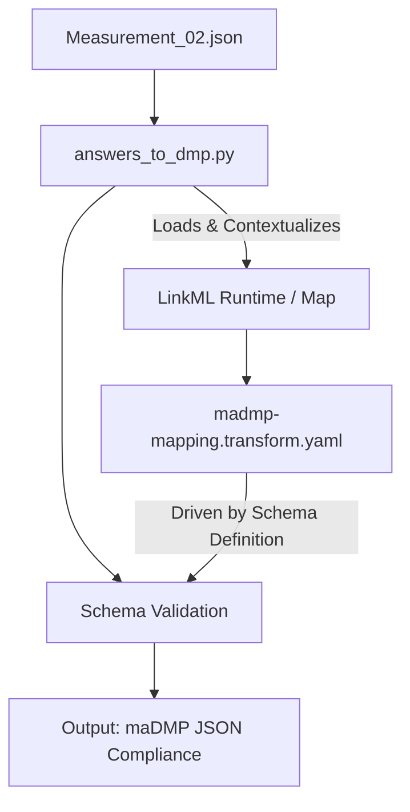

# 02 - DMP Erstellung

## Ziel

Mit Hilfe des RDMO wird ein einfacher DMP erstellt und präsentiert.

## Beschreibung

Ein Data Management Plan (DMP) wird unter Verwendung von RDMO (Research Data Management Organiser) erstellt. Dieser DMP dokumentiert, wie mit den Forschungsdaten im Rahmen des definierten Szenarios umgegangen wird.

## Aufgaben

- [x] RDMO-Projekt anlegen
- [x] DMP-Fragenbogen ausfüllen
- [x] Datenlebenszyklus dokumentieren
- [ ] Speicher- und Archivierungsstrategie definieren
- [x] Zugriffsrechte klären
- [x] DMP exportieren/presentieren

## Werkzeuge

- **RDMO** - Research Data Management Organiser

## Deliverables

- Exportierter DMP (PDF/XML)
	- DMP liegt aktuell in Form einer Markdown und einer JSON mit Antworten
	- DMP schema steht als Linkml zur Verfügung
	- Beide sind benutzt in `answers_to_dmp.py`  um `Measurement_02.dmp.json` zu generieren.
- Dokumentation der getroffenen Entscheidungen

## Notizen

### Transformation Workflow Explanation
We outline the workflow and mechanics of transforming unformatted or semi-structured measurement metrics (Measurement_02.json) into a machine-actionable Data Management Plan (maDMP) conforming to a target LinkML schema structure, utilizing a declarative LinkML Map specification (madmp-mapping.transform.yaml) and an orchestrating Python runner script (answers_to_dmp.py).

#### Architecture Overview
The data translation process bridges flat, questionnaire-style metric dumps with highly-nested, standardised metadata models.

#### Component Responsibilities
1. The Transformation Specification (madmp-mapping.transform.yaml)
The LinkML Map specification acts as a declarative contract. Instead of writing imperative data parsing loops inside code, it isolates the mapping rules:

   - Target Binding: Maps target classes (DMPData, Dataset, Project, etc.) defined in the core schema model to incoming source fields.
   - Expression Evaluation: Leverages embedded Python evaluation expressions (expr:) to dynamically query, filter, and restructure array-based key-value dictionaries (such as the questions and answers structure found in Measurement_02.json) directly into rich, strongly-typed JSON attributes.

2. The Execution Engine (answers_to_dmp.py)
The Python script loads the raw input payload, manages system arguments, links against runtime validation utilities, and executes the transformation specification layout:

	- Schema Introspection: Utilizes SchemaView from linkml_runtime.utils.schemaview to ingest schema constraints.
    - Transformation Execution: Employs ObjectTransformer from linkml_map.transformer.object_transformer to parse mapping specs row-by-row and compile the results.

#### Execution Steps
1. Input Ingestion: The script reads the raw measurement questionnaire file (Measurement_02.json) which stores data entries as a list of questions and answers.

2. Context Binding: The raw list is bound under a unified source context wrapper so that map expressions can traverse elements dynamically.

3. Mapping Evaluation: The madmp-mapping.transform.yaml rules evaluate inline expressions (e.g., matching strings like "main research question" or "project start" via conditional expressions) to populate scalar fields, nested contact structures, and project timelines.

4. Serialisation: The resulting data structure is validated against target rules and serialised into a compliant, structured maDMP JSON document.

#### Documentation to be revisited:

[LinkML Map Architecture](https://linkml.io/linkml-map/##architecture)

---

**Status:** ⏳ Ausstehend
**Vorheriger Schritt:** [[01_Definition_low_level_Beispiel]]
**Nächster Schritt:** [[03_SMS_Beschreibung]]
