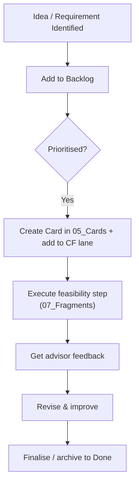

# Projecting Workflow Guide

This document outlines the unified workflow for managing **EDO project development** through a single kanban board, with every backlog action represented as a card file.

## Vision

The projecting workflow tracks EDO software development — and specifically its **feasibility study** — so that research, design and implementation decisions are made in one place. The feasibility study (`EDO/Artefacts/07_Fragments/`) acts as the concrete, step-by-step plan that implements the four EDO core functionalities (CF1–CF4). Its actions are promoted into individual **cards** and managed through the kanban.

## Project Structure

```
projecting_spaces/
├── .obsidian/                          # Obsidian configuration (kanban plugin settings)
├── Project Management Kanban.md        # SINGLE unified kanban
├── Projecting Workflow Guide.md        # This guide
└── EDO/                               # EDO project space
    ├── CF1.md                          # Core Function 1 — Access available source of Information
    ├── CF2.md                          # Core Function 2 — Present information in suitable form
    ├── CF3.md                          # Core Function 3 — Easy way to edit metadata
    ├── CF4.md                          # Core Function 4 — Publish & search via target platforms
    └── Artefacts/                      # EDO artefacts (feature-type documents)
        ├── 01_Constructs/              # Constructs
        ├── 02_Models/                  # Data models (e.g. mduid abstract model trees)
        ├── 03_Methods/                 # Methods (e.g. Databus, RDMO questionaries)
        ├── 04_Instantiations/          # Instantiations
        ├── 05_Cards/                   # ★ Action cards (linked from the kanban)
        ├── 06_Terms/                   # Terms
        ├── 07_Fragments/               # ★ Feasibility study steps (01–12)
        └── 08_Images/                  # Image assets
```

## Kanban Board Columns Explained

The kanban (Obsidian **Kanban plugin** board) is organised into **lanes by EDO core functionality (CF1–CF4)**, plus Backlog, Review, and Done.

### **Backlog**
- **Purpose**: Long-term planning for EDO
- **Content**:
  - High-level EDO functional requirement cards (CF1, CF2, CF3, CF4)
  - The high-level feasibility example (`[[12_High_Level_Wiederholung]]`)
- **When to add**: When you have an idea that needs further development before it is prioritised into a functional lane

### **CF1 — Access Available Sources of Information**
- **Purpose**: Work contributing to the ability to access and retrieve data from all relevant sources (RDMO, databases, registries, semantic resources)
- **Content**: Feasibility steps 01–05 (scenario definition, DMP creation, SMS description, internal format, LinkML schemas) plus the Databus/architecture cards
- **When to add**: When an action feeds the "access sources" capability

### **CF2 — Present Information in Suitable Form**
- **Purpose**: Work transforming and presenting retrieved data in a standardised format for consumption by system sub-components (Knowledge Base, Suggestion Engine)
- **Content**: Feasibility steps 06–09 (transformations, LinkML Map, DMP↔SMS linkage, RO-Crate generation) plus the maDMP-lightmodel / RDMO questionary cards
- **When to add**: When an action feeds the "transform & present" capability

### **CF3 — Easy Metadata Editing**
- **Purpose**: Work enabling a friendly, intuitive interface for editors, publishers and curators to review, modify and refine metadata
- **Content**: Feasibility step 10 (NovaCrate) plus the Mapping-procedure card
- **When to add**: When an action feeds the "metadata editing" capability

### **CF4 — Publish & Search via Target Platforms**
- **Purpose**: Work using target-platform APIs (e.g. institutional repositories, data portals, OEP) to publish rich metadata and enable searching
- **Content**: Feasibility steps 11 & 11b (OEP publishing + LinkML Map for target repository)
- **When to add**: When an action feeds the "publish & search" capability

### **Review & Feedback**
- **Purpose**: Quality assurance, peer review, and feedback cycles
- **Content**: Feasibility step 12 (high-level repetition, scalability analysis, lessons learned)
- **When to add**: After content is drafted/implemented and ready for feedback

### **Done**
- **Purpose**: Completed work ready for archiving
- **Content**: Completed EDO features/milestones, released versions, delivered feasibility steps
- **When to add**: After work is completed, reviewed, and finalised

## 🏷️ Actions Are Cards

Every actionable item in the kanban is backed by a **card file** in `EDO/Artefacts/05_Cards/`. The kanban links each card via a wiki-link (`[[CF1-003]]`).

### Card Naming Convention
Cards follow an ID scheme that groups them by functional requirement:

```
CF1-001     CF2-001   CF2-0011   CF3-001   CF4-001   REV-001
CF1-002     CF2-002   CF2-0021   CF3-002   CF4-002
CF1-003 …   CF2-003 …
```

- **`CF<n>-<###>`** — actions under core function *n*
- **`REV-###`** — review / synthesis tasks (e.g. the high-level repetition)

> **Keep IDs unique.** Before creating a card, check `05_Cards/` so you don't reuse an existing ID. New feasibility-study steps were given the next free IDs in their group (e.g. `CF1-003`, `CF2-003`, `CF3-002`, `CF4-001`).

### Card Template
Each card uses YAML frontmatter plus structured sections:

```yaml
---
id: <Short action title>
type: feature            # or review
priority: high           # high / medium / low
assignee: "@me"
created: YYYY-MM-DD
due: DD.MM.YYYY
tags:
  - priority/<value>
  - feado/<step>         # links to feasibility-study fragment
---
```

Body sections (as used by existing cards):
- **Business Context** — `As a … I want to … So that …`
- **Acceptance Criteria** — Given/When/Then scenarios
- **Technical Context & Resources** — links to fragments, tools, specs, branches
- **Activity Log / Notes** — dated `*YYYY-MM-DD:*` entries

### Linking Cards to the Feasibility Study
Each feasibility step in `EDO/Artefacts/07_Fragments/` (files `01_…` through `12_…`) maps to one card. The card's **Technical Context** links the fragment wiki-link. Conversely, the kanban card links back to the step.

**Step → CF mapping (for reference):**

| CF lane | Feasibility steps |
|---------|-------------------|
| CF1 | 01 Definition scenario, 02 DMP, 03 SMS, 04 Internal format, 05 LinkML |
| CF2 | 06 Transformations, 07 LinkML Map, 08 DMP↔SMS link, 09 RO Crate |
| CF3 | 10 NovaCrate |
| CF4 | 11 OEP publish, 11b LinkML Map OEP |
| Review | 12 High-level repetition |

## Best Practices

### Creating New Work
1. Add a card file in `05_Cards/` with a unique `CF<n>-<###>` / `REV-###` ID
2. Link the card into the appropriate kanban lane (Backlog initially, then move to a CF lane when prioritised)
3. Add the due date in the card frontmatter **and** (optionally) as `{{due::YYYY-MM-DD}}` on the kanban card

### Moving Work Through the Board
- **Backlog → CF lane**: when an action is prioritised/started
- **Within a CF lane**: work-in-progress; track state via the card's acceptance criteria checkboxes
- **CF lane → Review**: when ready for advisor/peer feedback
- **Review → Done**: when completed and finalised (optionally tag as `{{done::YYYY-MM-DD}}`)
- **Archive**: when a card's work is long complete, keep the card file (history) but clear it from the active lanes

### For EDO Feasibility Study Work
1. Each feasibility step lives as a fragment in `07_Fragments/` **and** a card in `05_Cards/`
2. Link the fragment and card to each other
3. Track each step's checkbox progress in the fragment; track the overall state in the kanban card

## Workflow Integration

The EDO feasibility study is the concrete execution plan for CF1–CF4. Implementation challenges surface new research and design questions that must be captured back into the workflow.



## Work Management Tips

1. **Use due dates** on cards (`due:` in frontmatter) and on the kanban (`{{due::YYYY-MM-DD}}`) to track deadlines
2. **Keep card IDs unique** — check `05_Cards/` before adding a new card
3. **Tag feasibility steps** with `feado/<step>` for filtering
4. **Schedule regular reviews** to assess progress
5. **Update frequently** — move cards between lanes as work progresses
6. **Archive regularly** — clean up the `Done` lane to maintain clarity (keep the card files)

## Tracking Progress

- Use the **Project Management Kanban** as your single source of truth
- Review weekly to update progress and re-prioritise

---

**Questions?**
- Contact: EDO project lead
- Reference: This guide is located at `projecting_spaces/Projecting Workflow Guide.md`

Last Updated: 2025-11-09
